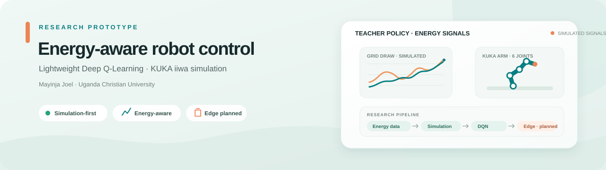

<div align="center">
  

  <h1>Energy-Aware Robot Control with Lightweight Deep Q-Learning</h1>

  <p>
    <strong>A research prototype exploring energy-aware control of a simulated industrial robot.</strong><br>
    Mayinja Joel · BSc Computer Science · Uganda Christian University
  </p>

  <p>
    <a href="https://www.python.org/"></a>
    <a href="https://gymnasium.farama.org/"></a>
    <a href="https://pybullet.org/"></a>
    <a href="https://pytorch.org/"></a>
    
  </p>

  <p>
    <a href="#project-overview">Overview</a> ·
    <a href="#current-progress">Progress</a> ·
    <a href="#quick-start">Quick start</a> ·
    <a href="#dashboard">Dashboard</a> ·
    <a href="#research-and-presentation">Research guide</a>
  </p>
</div>

---

## Project overview

Industrial robots can draw substantial energy during repeated movement. This project investigates whether a Deep Q-Network (DQN) can learn to control a simulated robot arm with energy use in mind, while maintaining task performance. The longer-term research plan also studies model distillation for low-cost edge hardware and operation under simulated grid instability.

The work is motivated by the energy and computing constraints that can affect manufacturing SMEs in Uganda. It is an academic research prototype—not a deployed factory controller.

### Research questions

1. How much energy per completed task can a DQN teacher save against a constant-speed controller in simulation?
2. How much teacher performance can a smaller distilled student retain, and can it run on a Raspberry Pi 4?
3. How does the controller perform under simulated brownouts, outages, and solar surplus?

| Stage | Purpose | Status |
|---|---|---|
| Industrial energy data | Explore steel-industry load patterns and motivate task scenarios. | Dataset and exploratory notebook are present; the CSV is not connected to DQN training. |
| Robot simulation | Model a KUKA iiwa arm and compare energy-related behavior. | PyBullet/Gymnasium environment code is present; live execution still needs verification. |
| Teacher DQN | Learn a discrete joint-velocity policy and compare it with a fixed-speed baseline. | Training pipeline is implemented; verified training results are not yet reported. |
| Student and edge deployment | Distill the teacher, export ONNX, and evaluate on Raspberry Pi 4. | Planned research work; not implemented or measured yet. |
| Physical-facing demonstration | Communicate the energy-buffer concept with an Arduino/Tinkercad mock-up. | Circuit illustration and simple threshold-based sketch are present; this is not the DQN or industrial robot. |

> **Research integrity:** the proposal's 20% energy-saving, 85% student-retention, and 100 ms Raspberry Pi latency values are targets to test—not achieved results. Dashboard values come from simulation, not physical robot measurements.

## Current progress

- Research proposal (Chapters 1–3) and a systematic literature review draft establish the motivation, research gap, and planned evaluation.
- The literature review screened 195 unique records and included six primary studies; it identifies a gap at the intersection of energy-aware DRL, policy distillation, and low-cost deployment.
- The repository includes a steel-industry CSV with **35,040 quarter-hourly observations from 2018**, plus a notebook for load-pattern exploration.
- The simulation source defines a 23-value observation, a 400-step episode, light/heavy phases, and an energy-buffer model.
- The dashboard provides Overview, Live monitoring, Data detection, and Model management pages.
- **Environment setup is still a blocker on Windows:** the latest reported PyBullet install stopped because Microsoft C++ Build Tools were missing. The live Flask training flow and model performance therefore remain unverified.

## Technical snapshot

| Area | Current prototype |
|---|---|
| Robot | PyBullet KUKA iiwa model: seven physical joints, six controlled, final wrist joint locked |
| Observation | 23 values: joint state, end-effector and target position, phase, buffer, grid draw, distance, and episode progress |
| Actions | 25 discrete choices: zero movement plus four non-zero velocity levels for each of six joints |
| Teacher network | PyTorch Q-network with two 256-unit hidden layers and a replay buffer |
| Simulation | 400-step episodes with seeded light/heavy targets and a simplified 50 Ws energy buffer |
| Current comparison | Fixed-speed inverse-kinematics baseline versus teacher policy |
| Dashboard | Flask API and responsive HTML dashboard |

The action values are **joint-velocity commands**, not torque commands. The current simulated energy estimate sums `|torque × angular velocity|` over the controlled joints. The steel-industry CSV is exploratory context; it contains no robot joint telemetry and is not currently used by the training loop.

> **Method alignment:** some proposal details—such as the richer motor-loss model, additional baselines, grid-state scenarios, student architecture, and Raspberry Pi evaluation—are not yet present in the current runner. See the [progress guide](docs/Progress_and_Presentation_Guide.pdf) for a detailed implementation-versus-plan checklist.

## Repository structure

```text
.
├── data/
│   ├── processed/                 # Generated/derived data (not committed)
│   └── raw/                       # Raw data location
├── docs/
│   ├── Progress_and_Presentation_Guide.pdf
│   └── project-banner.svg
├── models/                        # Generated model weights (not committed)
├── notebooks/
│   ├── dataset_prototype.ipynb
│   └── steel_data.csv
├── src/
│   ├── backend.py                 # Flask API and training controller
│   ├── launcher.py                # Starts frontend and backend
│   ├── dqn_teacher.py             # DQN agent and replay buffer
│   ├── environment.py             # Gymnasium/PyBullet robot environment
│   └── training.py                # Baseline and teacher training loop
├── tests/
├── tinkercad/                     # Arduino sketch and circuit concept
└── frontend/
    ├── assets/                    # Frontend images
    └── web.html                   # Standalone dashboard frontend
```

## Quick start (Windows)

1. Install **Python 3.10** and make sure the Python launcher (`py`) is available.
2. From Git Bash, enter the project folder and run the Windows launcher:

   ```bash
   cd /c/Users/JOEL/Desktop/DQN/Energy_consumption_DQN
   cmd.exe /c start_dashboard.bat
   ```

   You can also double-click `start_dashboard.bat` in File Explorer.
3. On first run, the launcher creates a small `.venv310` environment and installs Flask only. It starts the frontend and backend separately, then opens **http://127.0.0.1:8000**.
4. Keep the terminal open while using the dashboard. Press **Ctrl+C** there to stop both local servers.

The frontend is served at `127.0.0.1:8000`; its API runs at `127.0.0.1:5000`. The launcher starts both for you. Neither Codespaces nor Visual Studio Build Tools is needed to view the dashboard. The frontend and backend communicate across these local ports through a restricted CORS configuration.

The dashboard offers:

- **Overview** — progress cards and episode-energy charts.
- **Live monitoring** — training controls, live grid draw, energy buffer, and arm schematic.
- **Data detection** — simulation signals, threshold alerts, and completed episode results.
- **Model management** — upload a compatible PyTorch teacher `.pt`/`.pth` state dictionary and optionally initialize training from it, along with teacher settings and the student/edge research roadmap.

### Training setup without Visual Studio Build Tools

The launcher intentionally does **not** install the full training stack. The dashboard can open without PyBullet; training controls report clearly when the simulator is unavailable. The official PyPI PyBullet release does not provide a Windows wheel, so installing it with pip on Windows can require a C++ compiler.

For local Windows training without the Visual Studio C++ workload, install [Miniforge](https://github.com/conda-forge/miniforge) and create the optional prebuilt conda-forge environment from the project folder:

```powershell
conda env create --prefix .conda-training --file environment-training.yml
```

The launcher automatically uses `.conda-training` when it exists. Then start it the same way as above. The Conda environment is ignored by Git and can be removed later with `conda env remove --prefix .conda-training`.

If you prefer the existing Python 3.10 environment, installing the full `requirements.txt` with pip on Windows may require C++ Build Tools to build PyBullet. On Linux (including Codespaces), PyBullet's published wheel avoids that Windows compiler requirement.

## Dataset notes

The exploratory notebook is [notebooks/dataset_prototype.ipynb](notebooks/dataset_prototype.ipynb), and its CSV is [notebooks/steel_data.csv](notebooks/steel_data.csv). The supplied file has 35,040 rows, 11 columns, 15-minute observations across 2018, and light/medium/maximum load labels.

This is **industrial energy-consumption data, not robot telemetry**. It supports initial load-pattern exploration; a defensible method is still needed before using it to calibrate simulated task phases or grid scenarios.

## Tests

For the full test suite, first create the optional training environment described above. Then run from the project folder:

```bash
.conda-training\python.exe -m unittest discover -s tests -v
```

Tests cover dashboard endpoints, DQN action selection, environment behavior, and training updates. A passing test suite does not establish that the agent has learned an effective energy-saving policy.

## Customize the dashboard

1. Open the repository folder in VS Code.
2. Press **Ctrl+P** and open `frontend/web.html`.
3. Edit the HTML text and navigation, or adjust the CSS in its `<style>` block.
4. Put your own JPG or PNG in `frontend/assets/`, then reference it as `/assets/your-image.jpg`.
5. Refresh the browser. The launcher serves frontend files from the static frontend server and sends API requests to the Flask backend.

The frontend files are in [frontend/](frontend/); the backend API is in [src/backend.py](src/backend.py). The launcher is [src/launcher.py](src/launcher.py), and the frontend reads the backend on port 5000.

## Research and presentation

- [Project progress and presentation guide](docs/Progress_and_Presentation_Guide.pdf) — dataset rationale, proposal-to-code status, prototype explanation, talk track, and likely questions.
- [Tinkercad and Arduino notes](tinkercad/README.md) — physical-facing demonstration scope and limitations.
- [Arduino demo sketch](tinkercad/Energy_aware_code_demo.ino)

## Safety and scope

The Arduino/Tinkercad circuit is a low-voltage educational mock-up. It is separate from the Python teacher model. The project is simulation-based; **do not connect this prototype to mains power or an industrial robot**. Hardware deployment requires independent engineering, electrical, and safety validation.

## Author

**Mayinja Joel**<br>
BSc Computer Science · Uganda Christian University<br>
Registration No: S24B23/047
